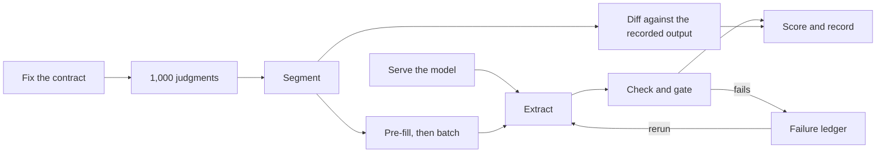

# criminal-judgment-extraction

<div align="center">

English | [中文](README.zh-CN.md)

</div>

## What it does

> The cost of analyzing even a moderate collection of texts long kept text-based measurement out of social science.<sup><a href="#ref-1">[1]</a>, <a href="#ref-2">[2]</a></sup> *Now open-weight models under a versioned prompt contract give social science a new way to read a large corpus, extract fields, and turn those fields into proxy measures.*
>
> This approach runs on a two-GPU workstation. On this pipeline, using Qwen3-Next, the local cost was about $70 per million cases, one-tenth to three-fifths of the $120–$670 per million evaluated for cloud interfaces, and nearly all of the automatically checked strings match the source text verbatim. *Accuracy, correctness, and cost stay together, with no costly frontier-model API and no data-center hardware, so corpus-scale text structuring becomes practical for individual researchers and small research teams.*

This repository is the complete extraction pipeline behind *A dataset of
itemized prior convictions and sentencing for 2.8 million criminal judgments
in China, 1985–2021*, a Data Descriptor currently under revision at
*Scientific Data*. It runs end to end on the sample that ships with it and
scores the run against the values recorded in the published
dataset.<sup><a href="#ref-3">[3]</a></sup>

## How it works



Quality here comes from constraint and checking, and it has little to do with
whether the model is large or small. Constraint acts at three points:

- Before generation: the contract nails down which keys the output has, what
  the schema looks like and where the thresholds sit.
- During generation: the system prompt says everything once, and it fixes the
  format of both the input and the output.
- After generation: every record goes through the schema check and the verbatim
  evidence check.

Records that fail are thrown into the failure ledger and pulled back into the
next batch for a rerun.

The three layers of constraint stacked together bring a self-hosted open-weight model
to release quality. A stronger model is of course an option, but only under
the same constraints, not a precondition.

One document through the contract:

```text
被告人×××，女，1982年9月28日生，汉族，甘肃省兰州市人，初中文化，无业，住甘肃省兰州市西固区。2014年4月28日因贩卖毒品罪被判处有期徒刑六个月。2016年1月27日因犯贩卖毒品罪被判处有期徒刑八个月，罚金1000元。2019年2月22日因犯贩卖毒品罪被判处有期徒刑十个月，罚金1000元。2019年10月3日刑满释放。2020年5月14日上午11时许，无业人员王某1通过微信联系被告人×××，欲购买400元钱的毒品，×××同意贩卖。于2021年2月18日向本院提起公诉。本院审查受理后，依法适用简易程序进行了审理。判决如下：被告人×××犯贩卖毒品罪，判处有期徒刑十个月；罚金1000元。
```

Names are masked for display only; the sample documents carry them as published.

<div align="center">

<p>↓<br/>
<strong>Pattern contract · JSON schema</strong><br/>
<sub>21 keys, 17 shown · verbatim evidence</sub><br/>
↓</p>

</div>

```json
{
  "id": "（2021）甘0104刑初45号",
  "sex": "女",
  "birth_year": 1982,
  "ethnicity": "汉",
  "edu_level": "初中",
  "prior_occupation_raw": "无业",
  "offense_name": "走私、贩卖、运输、制造毒品",
  "offense_start_date": "2020-05-14",
  "prosecution_date": "2021-02-18",
  "sentence_type": "有期徒刑",
  "sentence_months": 10,
  "fine_yuan": 1000,
  "has_prior_conviction": true,
  "prior_years": [2014, 2016, 2019],
  "prior_offenses": ["贩卖毒品", "贩卖毒品", "贩卖毒品"],
  "prior_sentence_months": [6, 8, 10],
  "prior_released_years": [null, null, 2019]
}
```

### Watch it run

The animation below follows one judgment through the flowchart above. The
contract is fixed, the record is extracted, one value fails the verbatim
evidence check, the record goes back through the failure ledger, passes on the
rerun and is scored.

https://github.com/user-attachments/assets/27939fbc-f60f-40cd-aeda-2eee182954ed

## Pattern as contract

[Fabric](https://github.com/danielmiessler/fabric) calls a reusable prompt a
*Pattern*. A Pattern is one Markdown file that holds the complete instruction
for one task and nothing else. This repository writes its prompts in that
format, and it thanks Fabric's authors here. We add only one thing. Each task
keeps its `pattern.md` beside its output schema, its acceptance thresholds and
its grounding check, and those four files together are a contract. The
production pattern of the main task is
[`pattern/criminal_defendant_v1.3.md`](pattern/criminal_defendant_v1.3.md), and
the run below sends it out unchanged.

What does the work is the constraint, not the wording. The pattern names all 21
output keys one by one, and it demands verbatim evidence from the source text
for each of them. The JSON schema rejects any output that does not conform.
The acceptance rules then score the final result. For a general discussion of
prompt design, see [The Prompt Report](https://arxiv.org/abs/2406.06608).

## How to replicate

**Rent a GPU → install an agent → copy the task prompt → let the agent run it.**

**Step 1.** Rent a GPU host that meets the [Requirements](#requirements) below.

**Step 2.** Install a coding agent on the GPU host. Then sign the agent in with
your subscription, or give it an API key from a model provider. Claude Code,
Codex, OpenCode and Pi are examples of such agents.

**Step 3.** Paste the whole of [`AGENT_TASK.md`](AGENT_TASK.md) into the agent
and let it get on with the job. If something breaks along the way, that is its
problem to solve, not yours.

**Step 4.** The agent then runs the reproduction. It clones the repository,
installs the environment, pulls the model from Hugging Face or ModelScope,
whichever suits the host's network, and serves it,
passes the smoke test, extracts all 1,000 documents and prints the gate table.

Running it by hand is not recommended. If you must, do Step 1, then work
through [`AGENT_TASK.md`](AGENT_TASK.md) yourself, in order from its step 0.

## Requirements

| | |
|---|---|
| Cards | 2 × NVIDIA RTX PRO 6000, 96 GB of GPU memory each |
| Host | Ubuntu 20.04 or later |
| CUDA | 12.8 or later |
| Disk | at least 165 GB free |

Hosts like this can be rented from [AutoDL](https://www.autodl.com/) in
mainland China or [Vast.ai](https://vast.ai/) elsewhere.

## Gates

| | |
|---|---|
| Records produced | ≥ 980 of 1,000 |
| Agreement with recorded values | ≥ 94.0% |
| Identifier preserved | 100% |
| Record failure rate | ≤ 2% |
| Throughput | ≥ 0.80 records/s |
| Deterministic diff | 0 mismatches |

A run on 5 November 2026 passed all six gates: 998 records, agreement 0.9723, 3.10 records/s. Its verdict is in [`02_extraction/runs/20261105_full1000/`](02_extraction/runs/20261105_full1000/).

The 1,000 documents were drawn by a seeded script, stratified by judgment year, with at least twelve from every year from 1995 to 2022. They sit with their expected output in [`examples/reproduction_sample/`](examples/reproduction_sample/README.md), beside a check that runs without a GPU.

## How to cite this repository

If you use this repository's code, or the approach it demonstrates, in your own research, please cite the paper and the repository.

Paper:

```bibtex
@unpublished{liang_2026_prior_convictions,
  author = {Liang, Zhenqiao},
  title  = {A dataset of itemized prior convictions and sentencing for 2.8 million criminal judgments in China, 1985--2021},
  year   = {2026},
  note   = {Manuscript under revise and resubmit at Scientific Data}
}
```

Repository:

```bibtex
@misc{liang_criminal_judgment_extraction,
  author  = {Liang, Zhenqiao},
  title   = {criminal-judgment-extraction},
  year    = {2026},
  version = {v1.0},
  url     = {https://github.com/liangzhenqiao/criminal-judgment-extraction},
  license = {Apache-2.0}
}
```

## One More Thing: Pattern Is All You Need

The approach is pluggable from beginning to end:

- The only thing that is specific to a task is the pattern.
- Swap the pattern and its schema, and the pipeline itself stays as it is.
- Any task that turns text into structured data can reuse it once the pattern
  is changed.

**Tip: keep revising the pattern contract until it is highly accurate.** This
matters most on a new task. Run a trial on a few dozen of your documents, read
the records it gets wrong, revise the pattern and rerun.

## Notes

<a id="ref-1"></a>[1] Grimmer, Justin, and Brandon M. Stewart. 2013. "Text as Data: The Promise and Pitfalls of Automatic Content Analysis Methods for Political Texts." *Political Analysis* 21 (3): 267–97. https://doi.org/10.1093/pan/mps028

<a id="ref-2"></a>[2] Le Mens, Gaël, Balázs Kovács, Michael T. Hannan, and Guillem Pros. 2023. "Uncovering the semantics of concepts using GPT-4." *Proceedings of the National Academy of Sciences* 120 (49): e2309350120. https://doi.org/10.1073/pnas.2309350120

<a id="ref-3"></a>[3] The sample is 1,000 real judgments from China Judgments Online (https://wenshu.court.gov.cn), together with the output the published dataset recorded for the same documents. To run the full corpus, replace them with the full input texts released with the paper on figshare (DOI: <https://doi.org/10.6084/m9.figshare.33188721>). A full replication of the corpus is estimated to take about 8 to 9 days.

## License

Data (the sample judgment texts) is CC BY 4.0; the code is Apache-2.0.
