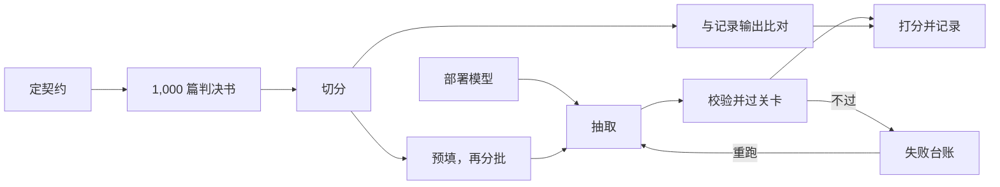

# criminal-judgment-extraction

<div align="center">

[English](README.md) | 中文

</div>

## 这个仓库做什么

> 哪怕只分析一批规模不大的文本，成本也高，基于文本的测量因此长期进不了社会科学。<sup><a href="#ref-1">[1]</a>, <a href="#ref-2">[2]</a></sup>*现在，开放权重模型配上版本化的提示词契约，给社会科学一条新路：大规模阅读文本、抽出字段，并做成代理变量。*
>
> 这条技术路线跑在一台双卡工作站上。这条流水线用 Qwen3-Next，本地成本大约每百万件案件 70 美元，是所评估的云端接口每百万件 120–670 美元的十分之一到五分之三；自动核对过的字符串几乎全部与原文逐字一致。*准确率、正确率和成本可以同时顾上，不必靠昂贵的前沿模型 API，也不必靠数据中心级别的硬件，个人研究者和小型研究团队也做得起语料规模的文本结构化。*

这个仓库就是 *A dataset of itemized prior convictions and sentencing for 2.8 million criminal judgments in China, 1985–2021* 背后完整的抽取流水线，这篇 Data Descriptor 目前在 *Scientific Data* 处于 R&R 状态。这条流水线在仓库自带的样本上从头跑到尾，再拿已发布数据集里的记录值给这次运行打分。<sup><a href="#ref-3">[3]</a></sup>

## 原理



质量来自约束和检查，跟模型是大还是小关系不大。约束卡在三个地方：

- 生成之前：契约把输出有哪些键、schema 长什么样、阈值定在哪里，全部写死。
- 生成的过程中：system prompt 一次把话说完，输入和输出都用固定格式。
- 生成之后：每一条记录都要过 schema 检查和逐字证据检查。

没通过的记录会被扔进失败台账，下一批再捞回来重跑。

三道约束叠在一起，一个自己部署的开放权重模型也能做出发布级的结果。想换更强的模型当然可以，但那只是同一套约束下的可选项，不是前提。

一篇文书经过契约：

```text
被告人×××，女，1982年9月28日生，汉族，甘肃省兰州市人，初中文化，无业，住甘肃省兰州市西固区。2014年4月28日因贩卖毒品罪被判处有期徒刑六个月。2016年1月27日因犯贩卖毒品罪被判处有期徒刑八个月，罚金1000元。2019年2月22日因犯贩卖毒品罪被判处有期徒刑十个月，罚金1000元。2019年10月3日刑满释放。2020年5月14日上午11时许，无业人员王某1通过微信联系被告人×××，欲购买400元钱的毒品，×××同意贩卖。于2021年2月18日向本院提起公诉。本院审查受理后，依法适用简易程序进行了审理。判决如下：被告人×××犯贩卖毒品罪，判处有期徒刑十个月；罚金1000元。
```

<div align="center">

<p>↓<br/>
<strong>pattern 契约 · JSON schema</strong><br/>
<sub>21 个键，下面列出 17 个 · 逐字证据</sub><br/>
↓</p>

</div>

```json
{
  "id": "（2021）甘0104刑初45号",
  "sex": "女",
  "birth_year": 1982,
  "ethnicity": "汉",
  "edu_level": "初中",
  "prior_occupation_raw": "无业",
  "offense_name": "走私、贩卖、运输、制造毒品",
  "offense_start_date": "2020-05-14",
  "prosecution_date": "2021-02-18",
  "sentence_type": "有期徒刑",
  "sentence_months": 10,
  "fine_yuan": 1000,
  "has_prior_conviction": true,
  "prior_years": [2014, 2016, 2019],
  "prior_offenses": ["贩卖毒品", "贩卖毒品", "贩卖毒品"],
  "prior_sentence_months": [6, 8, 10],
  "prior_released_years": [null, null, 2019]
}
```

### 看它跑一遍

下面的动画带一篇判决书走完上面的流程图：先定契约，再抽取；有一个值没通过逐字证据检查，记录进失败台账，回去重跑，通过后打分。

https://github.com/user-attachments/assets/27939fbc-f60f-40cd-aeda-2eee182954ed

## Pattern 即契约

[Fabric](https://github.com/danielmiessler/fabric) 把可以反复使用的 prompt 叫作 *Pattern*。一个 Pattern 就是一个 Markdown 文件，里面只放一个任务的完整指令，别的什么都不放。这个仓库的 prompt 就是照这个格式写的，这里向 Fabric 的作者致谢。我们只多做了一件事：每个任务的 `pattern.md` 都跟它的输出 schema、验收阈值、grounding 检查放在一起，这四个文件合起来，就是一份契约。主任务在用的正式 pattern 是 [`pattern/criminal_defendant_v1.3.md`](pattern/criminal_defendant_v1.3.md)，下面的运行会原样把它发出去。

真正起作用的是约束，不是措辞。pattern 把 21 个输出键挨个点出来，每个键都要求给出原文里的逐字证据。JSON schema 挡掉所有不合规的输出。验收规则再给最终的结果打分。prompt 设计的一般性讨论见 [The Prompt Report](https://arxiv.org/abs/2406.06608)。

## 如何复现

**租 GPU → 装 agent → 复制任务 prompt → 让 agent 跑完。**

**第 1 步。** 租一台满足下文[要求](#要求)的 GPU 主机。

**第 2 步。** 在这台 GPU 主机上装一个编码 agent，然后用你的订阅账号登录 agent，或者给它填一个模型服务商的 API key。Claude Code、Codex、OpenCode、Pi 这类工具都是这里说的 agent。

**第 3 步。** 把 [`AGENT_TASK.md`](AGENT_TASK.md) 整篇复制粘贴给 agent，剩下的活交给它。中途出了问题，那是它的事，让它自己解决。

**第 4 步。** 然后 agent 自己跑这次复现。它会克隆仓库、装好环境、按主机的网络从 Hugging Face 或 ModelScope 拉模型并起服务、跑过冒烟测试、抽完这 1,000 篇，最后把关卡表打印出来。

不建议手动复现。一定要手动的话，先做第 1 步，再按 [`AGENT_TASK.md`](AGENT_TASK.md) 从它的第 0 步起按顺序做。

## 要求

| | |
|---|---|
| 显卡 | 两张 NVIDIA RTX PRO 6000，每张 96 GB 显存 |
| 主机 | Ubuntu 20.04 及以上 |
| CUDA | 12.8 及以上 |
| 磁盘 | 空闲空间至少 165 GB |

这样的主机，中国大陆可以在 [AutoDL](https://www.autodl.com/) 租，中国以外可以在 [Vast.ai](https://vast.ai/) 租。

## 关卡

| | |
|---|---|
| 产出记录 | ≥ 980 / 1,000 |
| 与记录值一致率 | ≥ 94.0% |
| 标识符保留 | 100% |
| 记录失败率 | ≤ 2% |
| 吞吐 | ≥ 0.80 条/秒 |
| 确定性差异 | 0 处 |

2026 年 11 月 5 日的一次运行通过了全部六道关卡：产出 998 条，一致率 0.9723，每秒 3.10 条。结论文件在 [`02_extraction/runs/20261105_full1000/`](02_extraction/runs/20261105_full1000/)。

## 如何引用本仓库

如果你在自己的研究里用了这个仓库的代码，或者用了它这条技术路线，请引用论文和本仓库。

论文：

```bibtex
@unpublished{liang_2026_prior_convictions,
  author = {Liang, Zhenqiao},
  title  = {A dataset of itemized prior convictions and sentencing for 2.8 million criminal judgments in China, 1985--2021},
  year   = {2026},
  note   = {Manuscript under revise and resubmit at Scientific Data}
}
```

仓库：

```bibtex
@misc{liang_criminal_judgment_extraction,
  author  = {Liang, Zhenqiao},
  title   = {criminal-judgment-extraction},
  year    = {2026},
  version = {v1.0},
  url     = {https://github.com/liangzhenqiao/criminal-judgment-extraction},
  license = {Apache-2.0}
}
```

## One More Thing：Pattern Is All You Need

这条技术路线从头到尾都是可插拔的：

- 跟具体任务相关的只有 pattern 这一样东西。
- 把 pattern 和 schema 换掉，流水线本身不用改。
- 凡是把文本变成结构化数据的抽取任务，改一份 pattern 就能直接拿来用。

**提示：反复打磨 pattern 契约，直到准确率足够高。** 换到新任务时，这一条最要紧。先拿几十篇自己的文书试跑，看哪些记录抽错了，改 pattern，再试跑。

## 注释

<a id="ref-1"></a>[1] Grimmer, Justin, and Brandon M. Stewart. 2013. "Text as Data: The Promise and Pitfalls of Automatic Content Analysis Methods for Political Texts." *Political Analysis* 21 (3): 267–97. https://doi.org/10.1093/pan/mps028

<a id="ref-2"></a>[2] Le Mens, Gaël, Balázs Kovács, Michael T. Hannan, and Guillem Pros. 2023. "Uncovering the semantics of concepts using GPT-4." *Proceedings of the National Academy of Sciences* 120 (49): e2309350120. https://doi.org/10.1073/pnas.2309350120

<a id="ref-3"></a>[3] 样本是 1,000 篇来自中国裁判文书网（https://wenshu.court.gov.cn）的真实判决书，以及已发布数据集里同一批文书的记录输出。跑全量时，把它们换成随论文在 figshare 发布的全量输入文本（DOI: <https://doi.org/10.6084/m9.figshare.33188721>）。全量复现预计耗时约 8 到 9 天。

## 许可

Data (the sample judgment texts) is CC BY 4.0; the code is Apache-2.0.
